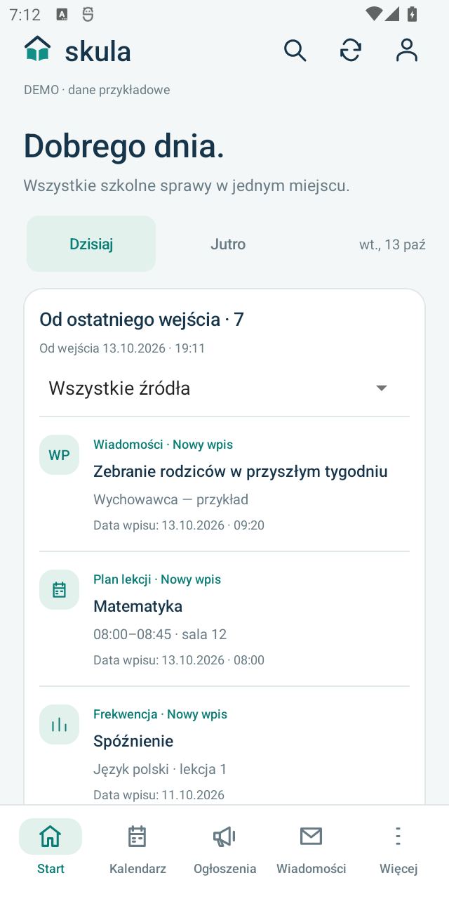
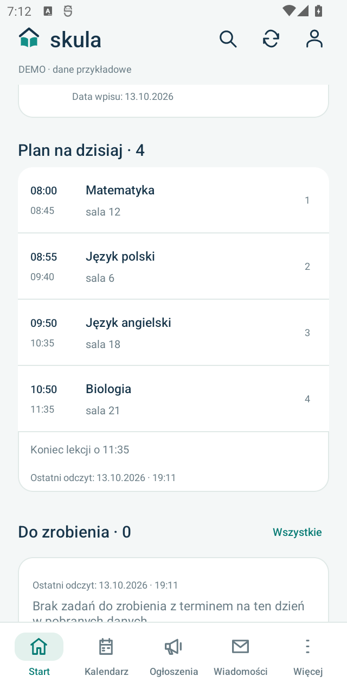
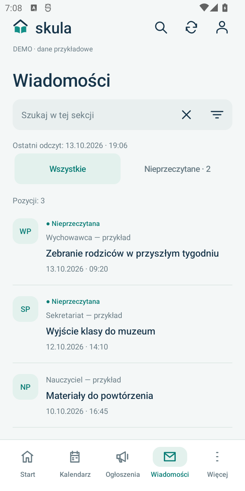
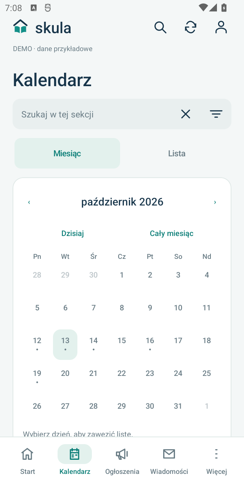

# Skula

**Twój dziennik szkolny — na telefonie i komputerze.**

Skula to otwarty, nieoficjalny klient dziennika Synergia. Pomaga sprawdzić plan lekcji, wiadomości, oceny i ważne terminy oraz wrócić do pobranych danych bez połączenia z internetem.

[Android](skula-android/README.md) · [Windows](skula-app/README.md) · [Wydania](https://github.com/slq/skula/releases) · [Zgłoś problem](https://github.com/slq/skula/issues) · [Licencja](skula-app/LICENSE)

Projekt jest niezależny i nie jest powiązany z producentem dziennika. Obie aplikacje są aktywnie rozwijane; zakres sprawdzonych scenariuszy opisują ich dokumentacje.

## Zobacz aplikację

Skula Android z fikcyjnymi danymi demo. Zrzuty przedstawiają interfejs wersji 0.14.0.

  
  
  
  

<em>Start i nowości · Pełny plan dnia · Wiadomości · Kalendarz</em>

## Wybierz platformę

| | Android | Windows |
| --- | --- | --- |
| **Interfejs** | Natywna aplikacja Java | Aplikacja Python / Tkinter |
| **Uruchomienie** | Instalacja APK | Skrypty Start i Demo |
| **Wymagania** | Android 8.0+, arm64-v8a; x86_64 dla emulatorów | Windows, Python 3.11+ z pip i tkinter |
| **Dane lokalne** | AES-GCM i Android Keystore | Windows DPAPI |
| **Instrukcje** | [Skula Android](skula-android/README.md) | [Skula dla Windows](skula-app/README.md) |

Obie wersje pokazują dane dziennika, obsługują wyszukiwanie i własne przypomnienia oraz mają tryb demo bez logowania. Szczegółowy zakres funkcji zależy od platformy.

### Wspólny motyw na Windows

Wersja desktopowa korzysta z tych samych kolorów i ikon, z boczną nawigacją oraz pełnym planem dnia na Starcie.

[Więcej zrzutów i instrukcja Windows](skula-app/README.md#wygląd-aplikacji).

## Szybki start

### Android

1. Wybierz plik APK z [wydania Androida](https://github.com/slq/skula/releases) lub [zbuduj go samodzielnie](skula-android/README.md#budowanie-ze-źródeł).
2. Zainstaluj aplikację na telefonie i uruchom **Zobacz demo** albo **Połącz konto Synergia**.
3. Kolejne wersje sprawdzaj przez **Więcej → Ustawienia → Aktualizacje aplikacji**.

[Instrukcja instalacji i obsługi Androida](skula-android/README.md#instalacja) opisuje także instalację przez USB, odczyty w tle, kopie i aktualizacje.

### Windows

Potrzebujesz standardowego Pythona **3.11 lub nowszego** z `pip` oraz `tkinter`.

1. Pobierz i rozpakuj [Skula Windows 0.3.0](https://github.com/slq/skula/releases/tag/windows-v0.3.0) albo sklonuj repozytorium.
2. Uruchom [Demo.cmd](skula-app/Demo.cmd), aby obejrzeć aplikację na fikcyjnych danych.
3. Uruchom [Start.cmd](skula-app/Start.cmd), aby połączyć konto Synergia.

Pierwsze uruchomienie tworzy środowisko `.venv` i pobiera zależności z PyPI, więc wymaga internetu. Instalator EXE nie jest jeszcze dostępny. [Dokumentacja Windows](skula-app/README.md).

## Dane i prywatność

Dane dziennika są pobierane bezpośrednio; lokalna kopia jest szyfrowana mechanizmami danej platformy. Zapamiętanie hasła jest opcjonalne.

Na Windows zapis znajduje się domyślnie w `%LOCALAPPDATA%\Skula\state.dpapi`; starsza lokalizacja `%LOCALAPPDATA%\SzkolnyPanel` pozostaje obsługiwana. Android używa prywatnego katalogu aplikacji i Android Keystore.

Eksport JSON z Androida nie zawiera hasła ani sesji, ale zawiera dane szkolne i wymaga prywatnego przechowywania. Szczegóły: [Android](skula-android/README.md#dane-i-prywatność), [Windows](skula-app/README.md#dane-lokalne-i-prywatność), [kopie danych](skula-android/BACKUPS.md).

Użytkownicy aplikacji sprzed zmiany nazwy na Skula powinni skorzystać z [instrukcji migracji](skula-android/MIGRATION.md). Przejście do nowego pakietu Androida wymaga eksportu i importu danych.

## Rozwój projektu

~~~text
skula/
├── skula-android/    # Aplikacja Android, testy i dokumentacja mobilna
│   ├── app/         # Java, Python, zasoby i testy urządzenia
│   ├── tests/       # Testy mobilnej warstwy Python
│   ├── tools/       # Synchronizacja integracji i przygotowanie wydań
│   └── docs/        # Zrzuty ekranu z danymi demo
└── skula-app/        # Aplikacja Windows i źródłowa integracja z dziennikiem
    ├── skula_app/
    └── tests/
~~~

Uruchomienie wersji Windows i jej testów w PowerShell:

~~~powershell
git clone --recurse-submodules https://github.com/slq/skula.git
cd skula/skula-app
py -3 -m venv .venv
.\.venv\Scripts\python.exe -m pip install -r requirements-dev.txt
.\.venv\Scripts\python.exe -m skula_app --demo
.\.venv\Scripts\python.exe -m pytest tests -q
~~~

Instrukcje dla Androida: [budowanie APK](skula-android/README.md#budowanie-ze-źródeł), [testy i ich ograniczenia](skula-android/TESTING.md), [wydania](skula-android/UPDATES.md), [historia zmian](skula-android/CHANGELOG.md). Wymagania funkcjonalne wersji desktopowej opisuje [USER_STORIES.md](skula-app/USER_STORIES.md).

Testy korzystają z danych syntetycznych. Nie potwierdzają zgodności z każdym kontem i każdą konfiguracją szkoły.

## Współpraca

Zgłoś błąd lub pomysł w [GitHub Issues](https://github.com/slq/skula/issues), podając platformę, wersję aplikacji, kroki odtworzenia i oczekiwane zachowanie. Do zmian interfejsu dołącz zrzuty demo, a do pull requestu opis rozwiązania i wykonanej weryfikacji.

Nie publikuj danych logowania, cookies, kopii kont, kluczy podpisu ani zrzutów z danymi uczniów lub nauczycieli. [Wskazówki dla zmian Androida](skula-android/README.md#współpraca) opisują współdzielenie integracji z wersją desktopową.

## Licencja

Kod aplikacji jest dostępny na **AGPL-3.0-or-later**: [Windows](skula-app/LICENSE) · [Android](skula-android/LICENSE).

Pochodzenie integracji i licencje zależności: [Windows](skula-app/THIRD_PARTY_NOTICES.md) · [Android](skula-android/THIRD_PARTY_NOTICES.md). Udostępniając aplikację, zachowaj odpowiednie źródła i informacje licencyjne.
