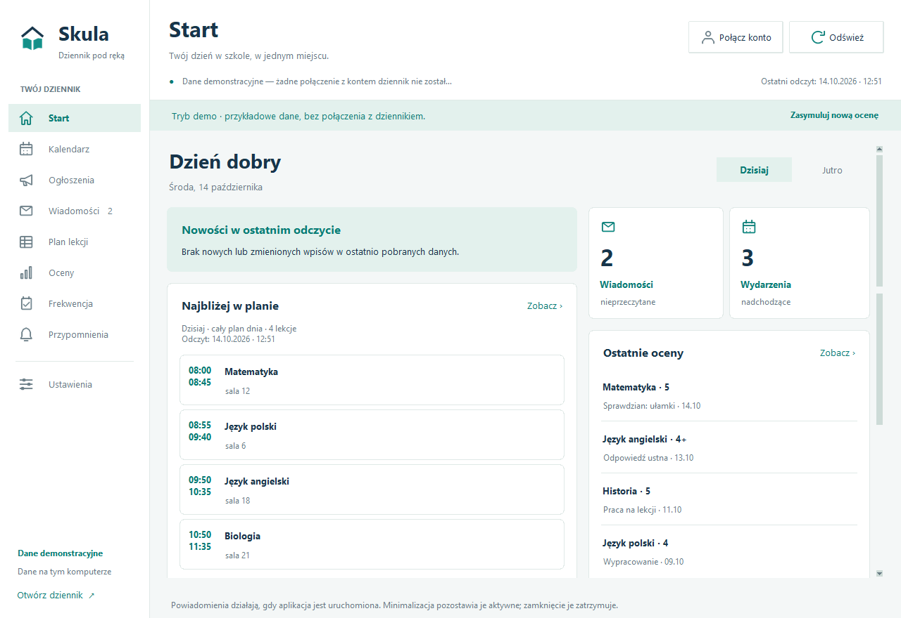
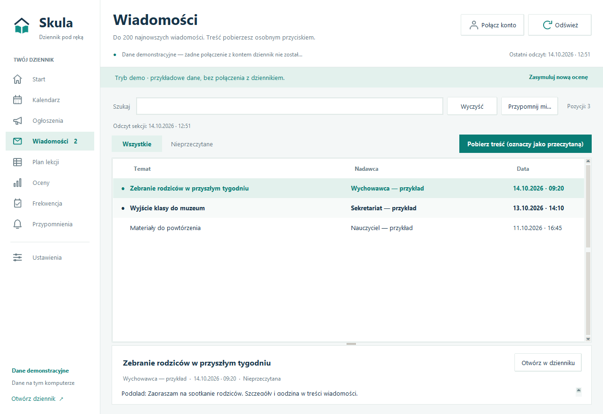
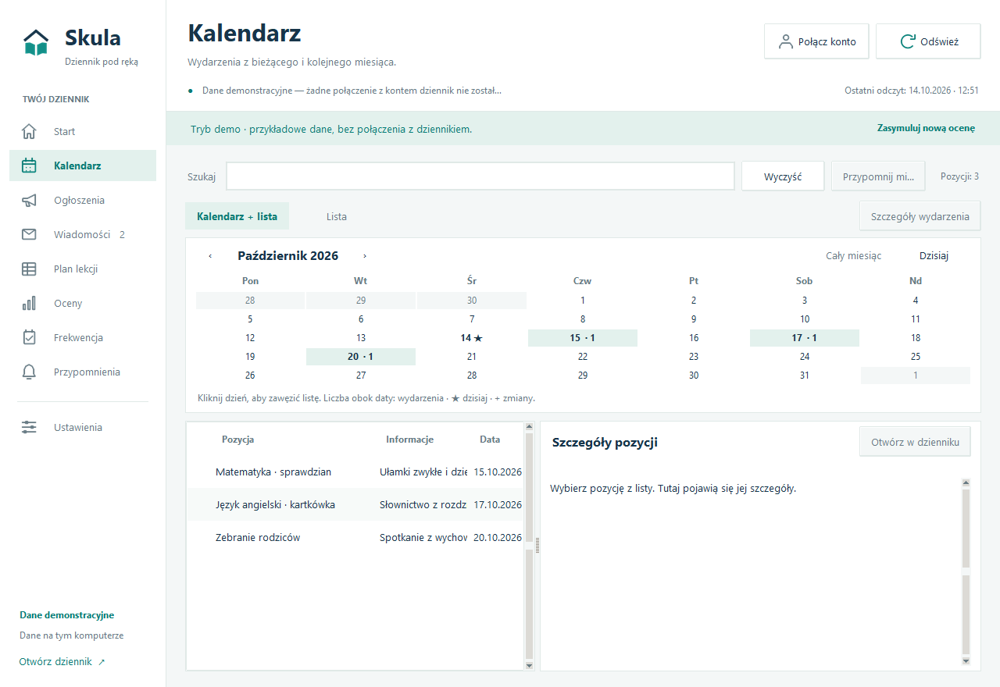
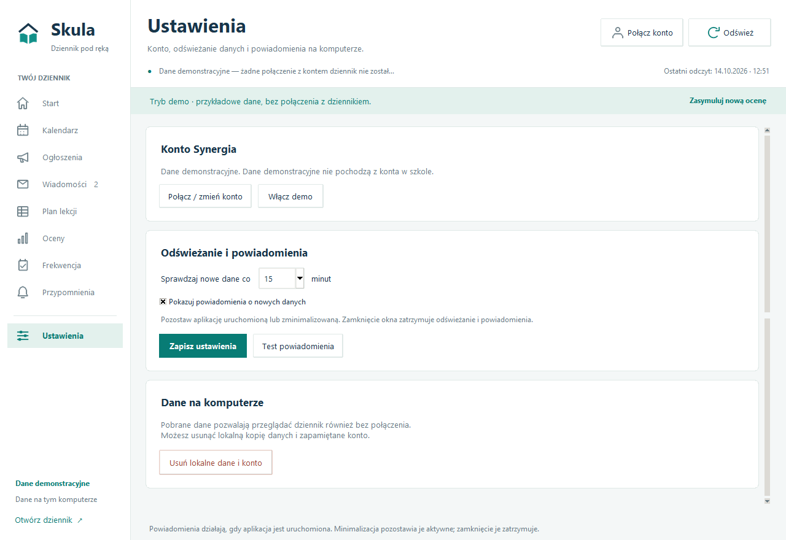

# Skula

Lokalny, nieoficjalny klient konta **dziennika Synergia** dla Windows. Wyświetla dane dziennika, okresowo sprawdza zmiany i umożliwia planowanie własnych przypomnień.

**Wersja: 0.2.0. Status: wersja rozwojowa.** Integracja korzysta z nieoficjalnych bibliotek i własnego adaptera logowania; zmiany po stronie dziennika lub konfiguracja szkoły mogą wymagać dostosowania kodu. Projekt nie jest powiązany z producentem dziennika.

[Opis repozytorium](https://github.com/slq/skula) · [Historie użytkownika i kryteria akceptacji](USER_STORIES.md) · [Licencja](LICENSE) · [Źródła i zależności](THIRD_PARTY_NOTICES.md)

## Wygląd aplikacji

Jasny motyw zgodny wizualnie ze Skulą na Androida: wspólne kolory, znak aplikacji, ikony, miętowe zaznaczenia i karty. Układ desktopowy wykorzystuje boczną nawigację i dwie kolumny na Starcie.

<p align="center">
  <a href="docs/screenshots/start.png"></a>
  <a href="docs/screenshots/messages.png"></a>
  <a href="docs/screenshots/calendar.png"></a>
  <a href="docs/screenshots/settings.png"></a>
</p>

Zrzuty przedstawiają działającą aplikację na Windows, wyłącznie z fikcyjnymi danymi demo. Kliknij obraz, aby zobaczyć pełny rozmiar.

Start pokazuje cały pobrany plan na **Dzisiaj / Jutro**. Nowości obejmują wszystkie wpisy oznaczone jako nowe lub zmienione w ostatnim odczycie; desktop nie przechowuje jeszcze historii „od ostatniego wejścia” znanej z Androida. Dłuższe listy przewijasz bez dodatkowego rozwijania. Kliknięcie wpisu otwiera jego lokalny podgląd.

## Wymagania i uruchomienie

- Windows z obsługą powiadomień systemowych i DPAPI.
- Standardowy Python **3.11 lub nowszy**, wraz z `pip` i `tkinter`. Testy sprawdzane są na Pythonie 3.12. Nie używaj dystrybucji „embeddable”.
- Internet do instalacji bibliotek i synchronizacji konta.

Pobierz [Skula Windows 0.2.0](https://github.com/slq/skula/releases/tag/windows-v0.2.0), rozpakuj plik `Skula-windows-0.2.0.zip` i otwórz utworzony folder. Możesz też sklonować repozytorium i otworzyć `skula-app`. Nie uruchamiaj skryptów bezpośrednio z archiwum.

| Skrypt | Działanie |
|---|---|
| `Demo.cmd` | Uruchomienie na fikcyjnych danych, bez logowania |
| `Start.cmd` | Uruchomienie aplikacji i połączenie konta Synergia |
| `Sprawdz-srodowisko.cmd` | Sprawdzenie Pythona i bibliotek, bez odczytu konta |

Przy pierwszym uruchomieniu `Start.cmd` tworzy `.venv` i pobiera zależności z PyPI. Kolejne uruchomienia korzystają z tego środowiska. Nie ma jeszcze instalatora EXE.

Demo nie zastępuje zapisu prawdziwego konta. Możesz w nim obejrzeć sekcje, ustawić tymczasowe przypomnienia oraz użyć **Ustawienia → Test powiadomienia** i **Zasymuluj nową ocenę**.

## Aktualizacja aplikacji

Zamknij poprzednią wersję, rozpakuj nowe wydanie do osobnego folderu i uruchom jego `Start.cmd`. Pierwsze uruchomienie przygotuje własne środowisko `.venv`; nie kopiuj go ze starej paczki. Szyfrowane dane konta i przypomnienia pozostają w dotychczasowym folderze danych Windows. [Opis zmian 0.2.0](RELEASE_NOTES.md).

## Połączenie konta

1. Uruchom `Start.cmd` i wybierz **Połącz konto**.
2. Podaj login Synergii otrzymany ze szkoły i hasło. Nie musi to być adres e-mail Konta dziennika używanego w aplikacji mobilnej.
3. Jeśli chcesz, zaznacz **Zapamiętaj konto na tym komputerze**. Domyślnie ta opcja jest wyłączona.
4. Porównaj pobrane dane z oficjalnym panelem. Każda sekcja pokazuje czas ostatniego poprawnego odczytu i ewentualny błąd.

Pierwszy poprawny odczyt sekcji ustala punkt odniesienia bez powiadomień o starych wpisach. Kolejne odczyty wykrywają nowe i zmienione informacje. Po ponownym uruchomieniu aplikacja wykorzystuje poprzedni zapis dla tego samego konta.

## Dostępne sekcje

| Sekcja | Zakres |
|---|---|
| Start | Pełny plan dzisiaj/jutro, nowości z ostatniego odczytu, ostatnie oceny, nadchodzące wydarzenia i nieprzeczytane wiadomości |
| Oceny | Oceny numeryczne i opisowe, daty, kategorie i komentarze |
| Wiadomości | Do 200 najnowszych nagłówków, nadawca, data i status przeczytania; osobne pobieranie treści |
| Ogłoszenia | Tytuł, autor, data i treść; wyszukiwanie i wykrywanie zmian |
| Kalendarz | Bieżący i kolejny miesiąc, kalendarz z listą lub sama lista |
| Frekwencja | Wpisy udostępnione przez dziennika |
| Plan lekcji | Bieżący i kolejny tydzień oraz zmiany zwracane przez bibliotekę |
| Przypomnienia | Własne alerty z terminem, edycja, usuwanie i lista wykonanych przypomnień |
| Ustawienia | Konto, częstotliwość odświeżania i powiadomienia |

Listy obsługują wyszukiwanie i sortowanie. Przy błędzie sekcji pozostaje ostatnia poprawna kopia wraz z czasem odczytu.

### Wiadomości

Przełącznik **Wszystkie / Nieprzeczytane** działa razem z wyszukiwaniem na lokalnej kopii. Zmiana filtra nie pobiera treści i nie oznacza wiadomości jako przeczytanej.

Synchronizacja pobiera nagłówki bez wywoływania szczegółu wiadomości. **Pobierz treść (oznaczy jako przeczytaną)** pobiera szczegół; dziennik może wtedy oznaczyć wiadomość jako przeczytaną. Przycisk znajduje się w stałym pasku nad listą i pozostaje widoczny po zwinięciu podglądu. Aktywuje się po wybraniu wpisu.

Treść wyświetla się bez aktywnego HTML i zewnętrznych obrazów. Pełna pobrana treść nie trafia do trwałej kopii. Załączniki otwierasz w oficjalnym dzienniku.

### Ogłoszenia

Treść jest pobierana wraz z listą i dostępna po wybraniu wpisu. Pierwszy odczyt jest cichy, a kolejne wykrywają nowe wpisy i zmiany treści. Biblioteka nie udostępnia identyfikatora ogłoszenia, więc wpis rozpoznawany jest po tytule, autorze i dacie; zmiana tych pól oznacza nowy wpis.

### Kalendarz

Domyślny widok **Kalendarz + lista** pokazuje miesiąc z wydarzeniami i listę poniżej. Strzałki zmieniają miesiąc, a liczba przy dniu oznacza liczbę wydarzeń pasujących do wyszukiwania. Gwiazdka oznacza dzisiaj, „+” nowe lub zmienione wpisy.

Kliknięcie dnia zawęża listę; ponowne kliknięcie albo **Cały miesiąc** przywraca wpisy miesiąca. **Dzisiaj** wybiera aktualny dzień. **Lista** ukrywa kalendarz i pokazuje wszystkie pobrane wpisy. Wybór wydarzenia pokazuje szczegóły, a dwuklik otwiera osobne okno.

Nawigacja korzysta z lokalnej kopii. Miesiące poza zakresem ostatniego odczytu są oznaczone jako niepełne.

## Powiadomienia o zmianach

Domyślnie dane są odświeżane **co 15 minut**; dostępne są odstępy 10, 15, 30 i 60 minut. Powiadomienie pojawia się przy kolejnym odczycie. Zmiana samego statusu „przeczytana” nie jest nowym zdarzeniem.

Powiadomienie systemowe zawiera liczbę zmian, bez nazwiska dziecka, ocen lub treści wiadomości. Szczegóły znajdziesz w aplikacji. Po błędach odświeżanie zwalnia, a HTTP 429 wstrzymuje nowe próby na co najmniej godzinę.

**Aplikacja musi działać, także po zminimalizowaniu.** Zamknięcie okna, wyłączenie lub uśpienie komputera zatrzymuje synchronizację. Projekt nie instaluje usługi Windows ani nie dodaje się sam do autostartu.

Tryb „Nie przeszkadzać” i ustawienia Windows mogą ukryć baner. Sukces testu oznacza przyjęcie powiadomienia przez system, bez gwarancji wyświetlenia go na ekranie.

## Własne przypomnienia

1. W **Ogłoszeniach**, **Kalendarzu** lub **Wiadomościach** wybierz wpis i kliknij **Przypomnij mi…**.
2. Podaj treść do 200 znaków, datę `dd.mm.rrrr` i godzinę `gg:mm`. Możesz wybrać **Za 15 minut**, **Za godzinę** lub **Jutro 09:00**. Termin musi być w przyszłości i używa lokalnego czasu komputera.
3. Wybierz, czy **Pokaż treść w powiadomieniu Windows**. Po wyłączeniu tej opcji baner zawiera ogólny komunikat.
4. W **Przypomnieniach** możesz edytować i usuwać alerty oraz wracać do źródłowych wpisów. Zmiana terminu wykonanego alertu planuje go ponownie.

Przypomnienia są jednorazowe. Terminy są sprawdzane co sekundę, niezależnie od synchronizacji i ustawienia powiadomień o nowych danych. Alerty działają offline, ale aplikacja musi być uruchomiona. Po wznowieniu lub ponownym uruchomieniu zaległe alerty pojawią się przy najbliższym sprawdzeniu; aplikacja nie budzi komputera.

Alert otwiera również okno w aplikacji. Jeśli Windows nie przyjmie powiadomienia, otrzymuje status **Wykonane w aplikacji**. Błąd zapisu wykonania może spowodować ponowienie po restarcie.

Przypomnienia są zapisywane wraz z lokalną kopią, także bez zapamiętania hasła. Są oddzielne dla kont i zachowują stan po restarcie lub zmianie roku szkolnego. W demo są tymczasowe. **Usuń lokalne dane i konto** usuwa również przypomnienia z aktywnego zapisu.

## Dane lokalne i prywatność

Nowe instalacje zapisują stan w:

```text
%LOCALAPPDATA%\Skula\state.dpapi
```

Jeśli istnieje zapis poprzedniej aplikacji w `%LOCALAPPDATA%\SzkolnyPanel\state.dpapi`, Skula nadal go używa, dopóki nie ma zapisu w nowym folderze. Nie przenosi ani nie scala kont. W razie obecności obu plików wybiera zapis `Skula`. Zachowano zgodność formatu szyfrowanego pliku.

Zapis zawiera ostatnio pobrane dane, stan wykrywania zmian i przypomnienia. Login i hasło znajdują się w nim wyłącznie po wybraniu zapamiętania konta. Cookies sesji nie są zapisywane. Cały plik jest szyfrowany przez **Windows DPAPI CurrentUser**, powiązany z kontem Windows. Programy działające z uprawnieniami tego samego użytkownika mogą uzyskać dostęp do tych danych; podczas pracy są one również obecne w pamięci aplikacji.

Zapytania o dane konta trafiają do dozwolonych hostów dziennika przez HTTPS. Aplikacja nie zawiera zewnętrznej analityki ani wysyłania danych do modeli AI. Zależności są pobierane z PyPI przy przygotowaniu środowiska.

**Usuń lokalne dane i konto** usuwa aktywny zapis aplikacji, bez zmiany danych w szkole. Odznaczenie zapamiętywania przy ponownym połączeniu usuwa zapisane hasło również po nieudanym logowaniu. Błąd zapisu lub usuwania jest pokazywany w interfejsie.

Bez zapamiętanego hasła można przeglądać kopię lokalną; odświeżanie wymaga logowania. Na systemach innych niż Windows magazyn działa wyłącznie w pamięci, a natywne powiadomienia są wyłączone.

Nie publikuj haseł, cookies, plików `state.dpapi` ani zrzutów z danymi uczniów lub nauczycieli. Przed zgłoszeniem błędu zanonimizuj zrzut; podaj wersję aplikacji, sekcję i komunikat błędu.

## Aktualizacja ze SzkolnyPanel

1. Zamknij poprzednią aplikację przed uruchomieniem Skula.
2. Pobierz nowe pliki repozytorium i uruchom `skula-app/Start.cmd`.
3. Okno powinno mieć tytuł **Skula 0.2.0**. Konto, kopia i przypomnienia ze starego folderu danych pozostają dostępne.

Pakiet Pythona zmienił nazwę na `skula_app`. Przy ręcznym uruchamianiu używaj `python -m skula_app`. Windows rejestruje powiadomienia pod nową nazwą **Skula**, dlatego sprawdź ich ustawienia i wykonaj test po aktualizacji.

Jeśli `.venv` została przeniesiona z innego katalogu lub przestała działać, odtwórz ją w folderze aplikacji. Zapis konta znajduje się poza tym folderem.

## Ograniczenia i rozwiązywanie problemów

Nie ma jeszcze wysyłania odpowiedzi, usprawiedliwiania nieobecności, pobierania załączników, osobnego modułu prac domowych ani wielu kont jednocześnie. Licznik wiadomości obejmuje najwyżej 200 pobranych wpisów. Aplikacja nie wylicza własnych średnich ani procentu frekwencji.

Logowanie interaktywne przez przeglądarkę, 2FA i CAPTCHA nie są obsługiwane. **Otwórz w dzienniku** prowadzi do oficjalnej sekcji w przeglądarce, która może wymagać osobnego logowania.

| Problem | Co sprawdzić |
|---|---|
| Brak Pythona lub okna aplikacji | Uruchom `Sprawdz-srodowisko.cmd`; sprawdź Python 3.11+, pip i tkinter |
| Instalacja bibliotek nie działa | Sprawdź komunikat konsoli i internet; `Start.cmd` ponawia instalację |
| Błąd logowania | Sprawdź login Synergii i logowanie w oficjalnym panelu; zanotuj etap i kod HTTP |
| Wiadomości nie działają | Zanotuj komunikat sekcji. Adapter obsługuje przekierowanie skrzynki z HTTP do HTTPS; po aktualizacji uruchom aplikację ponownie |
| Brak banera Windows | Sprawdź ustawienia Skula i tryb „Nie przeszkadzać”; użyj testu powiadomienia |
| Brak powiadomień o starych wpisach | Pierwszy odczyt ustala punkt odniesienia i jest cichy |
| Uszkodzone lub przeniesione środowisko | Odtwórz tylko `.venv` w folderze aplikacji; zachowaj plik danych konta |

## Rozwój i weryfikacja

Z folderu `skula-app` w PowerShell:

```powershell
py -3 -m venv .venv
.\.venv\Scripts\python.exe -m pip install -r requirements-dev.txt
.\.venv\Scripts\python.exe -m skula_app --demo
.\.venv\Scripts\python.exe -m pytest tests -q
```

| Moduł | Odpowiedzialność |
|---|---|
| `skula_app/ui.py` | Okno Tkinter, listy, logowanie i komunikaty |
| `skula_app/theme.py`, `assets/` | Kolory, style, karty i lokalne ikony wspólnego motywu |
| `skula_app/home_view.py` | Start: lokalny plan dnia, nowości i skróty do wpisów |
| `skula_app/calendar_view.py` | Kalendarz i przełączanie widoków terminarza |
| `skula_app/reminders.py`, `reminder_view.py` | Terminy alertów, formularz i lista przypomnień |
| `skula_app/core.py` | Worker, harmonogram, konto i wykrywanie zmian |
| `skula_app/connector.py` | Logowanie, adaptery dziennika i normalizacja danych |
| `skula_app/data.py` | Kopie danych, identyfikacja zmian i dane demo |
| `skula_app/platform_windows.py` | DPAPI i systemowe powiadomienia |
| `tests/` | Testy syntetyczne, izolowany magazyn i testy Tkinter |

Testy obejmują logowanie na syntetycznym transporcie HTTP, obsługę przekierowań, ochronę danych w diagnostyce, wykrywanie zmian, awarie zapisu, DPAPI, przypomnienia i układ interfejsu. Testy powiadomień sprawdzają rzeczywisty kod PowerShell bez wysyłania banerów. Testy korzystają z osobnego katalogu danych i nie odczytują zapisanego konta użytkownika. Nie zastępują weryfikacji konkretnego konta dziennika.

Weryfikacja motywu z 14 października 2026: **180 testów zaliczonych, 2 pominięte i 16 subtestów zaliczonych**, Windows 11, Python 3.12.10. Sprawdzono pełne listy 12 lekcji i 8 nowości, długie tytuły, przełączanie dni, filtry wiadomości, podgląd konkretnego wpisu bez odczytu sieciowego oraz okna 1080×720 i 1280×880. Pominięte testy dotyczą działania poza Windows. Dane konta, DPAPI, adapter i harmonogram pozostały bez zmian.

Zrzuty demo można odtworzyć przez `.venv/Scripts/python.exe tools/capture_theme.py`. Narzędzie pokazuje na chwilę własne okno demo i zapisuje wyłącznie jego obraz do `docs/screenshots/`; nie odczytuje zapisanego konta. Ikony są dołączone do aplikacji. Ich opcjonalne odtworzenie przez `tools/generate_theme_icons.py` wymaga Pillow wyłącznie w środowisku deweloperskim.

Nie ustawiaj globalnego polskiego `LC_TIME`: `librus-apix` porównuje dzień tygodnia z angielskim `Monday`. UI formatuje daty samodzielnie. Powiadomienia korzystają ze stałego programu PowerShell/WinRT, a tekst jest przekazywany jako JSON przez stdin.

### Przygotowanie wydania Windows

Uruchom `python tools/prepare_release.py` z katalogu `skula-app`. Skrypt zapisuje ZIP oraz SHA-256 w ignorowanym katalogu `dist/`. Paczka zawiera odpowiadające źródła, lokalne ikony, zrzuty i licencje; pomija środowisko `.venv`, lokalne dane i pliki kompilacji.

Publikuj pod tagiem `windows-vX.Y.Z`. W GitHub Releases pozostaw **Release label: None**, ponieważ **Latest** wskazuje wydanie Androida używane przez aktualizator telefonu. Po publikacji sprawdź zarówno ZIP Windows, jak i adres metadanych aktualizacji Androida.

## Licencja i źródła

Kod aplikacji i testów: **AGPL-3.0-or-later**, pełny tekst w [LICENSE](LICENSE). Pochodzenie integracji oraz licencje zależności opisuje [THIRD_PARTY_NOTICES.md](THIRD_PARTY_NOTICES.md). Zachowaj te informacje przy udostępnianiu projektu.

Nazwy dziennika i Synergia należą do ich właścicieli. Skula jest niezależnym, nieoficjalnym klientem.
